<div align="center">


# cove

### a quiet cove on Hyprland

Shell, editor, terminal and browser — one system in one style.<br>
Change the wallpaper and everything recolors. Configure it with the mouse, never touch a config.

[](https://archlinux.org)
[](https://hypr.land)
[](https://quickshell.org)
[](LICENSE)

[Русский](README.md) · **English**

<br>

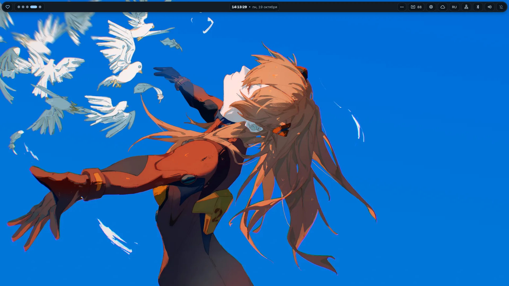

<sub>Screenshots show the Russian interface — English is one switch away in Settings.</sub>

</div>

---

## At a glance

<table>
<tr>
<td width="50%">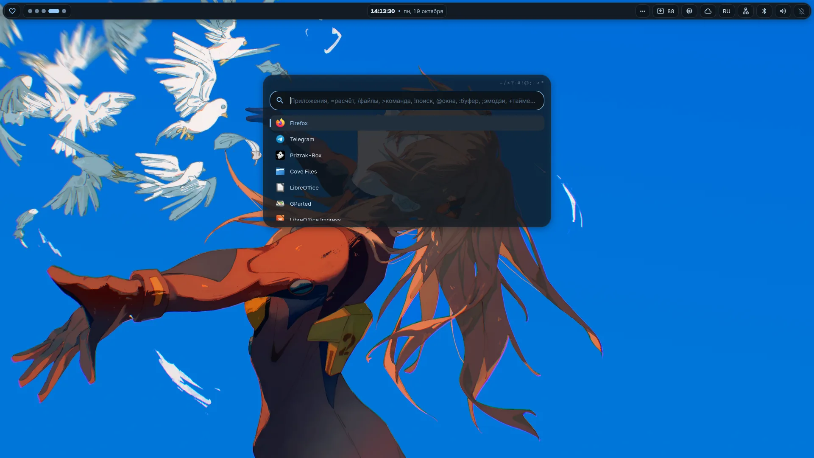<br><sub><b>Launcher</b> — apps, math, files, windows, clipboard, emoji and an assistant in one line</sub></td>
<td width="50%">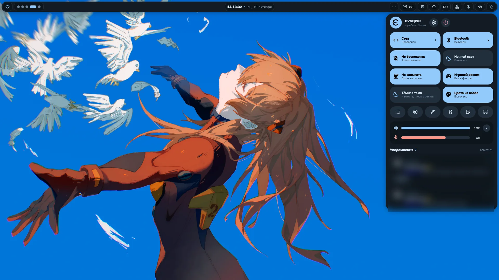<br><sub><b>Control center</b> — network, Bluetooth, audio, Do Not Disturb, game mode, wallpaper colors</sub></td>
</tr>
<tr>
<td>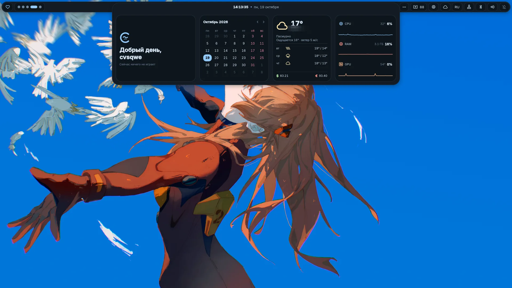<br><sub><b>Island dashboard</b> — greeting, calendar, weather, rates and system load</sub></td>
<td>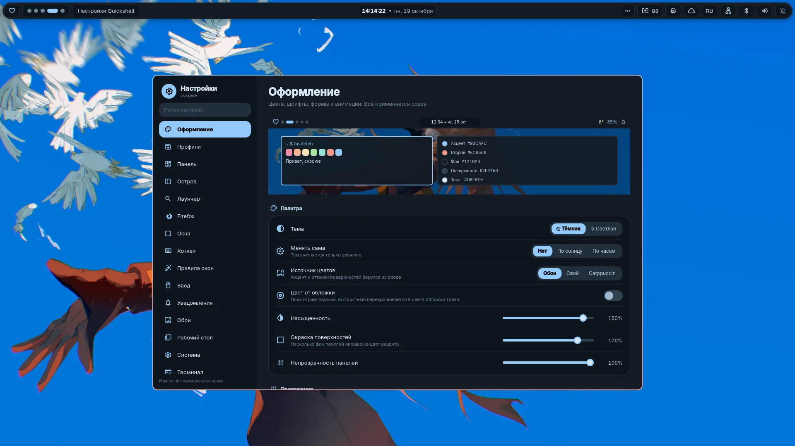<br><sub><b>Settings</b> — 19 sections, every change applies instantly with a live preview</sub></td>
</tr>
<tr>
<td>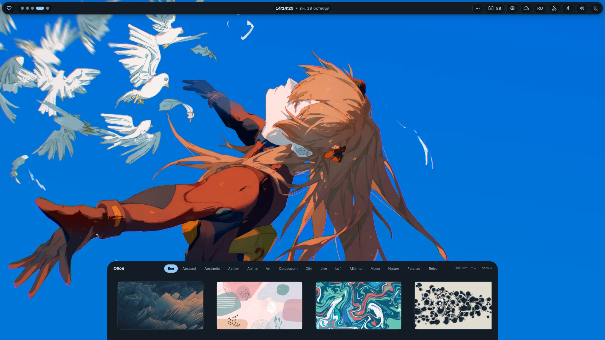<br><sub><b>Wallpapers</b> — hundreds of images and live video wallpapers, tabbed by style</sub></td>
<td>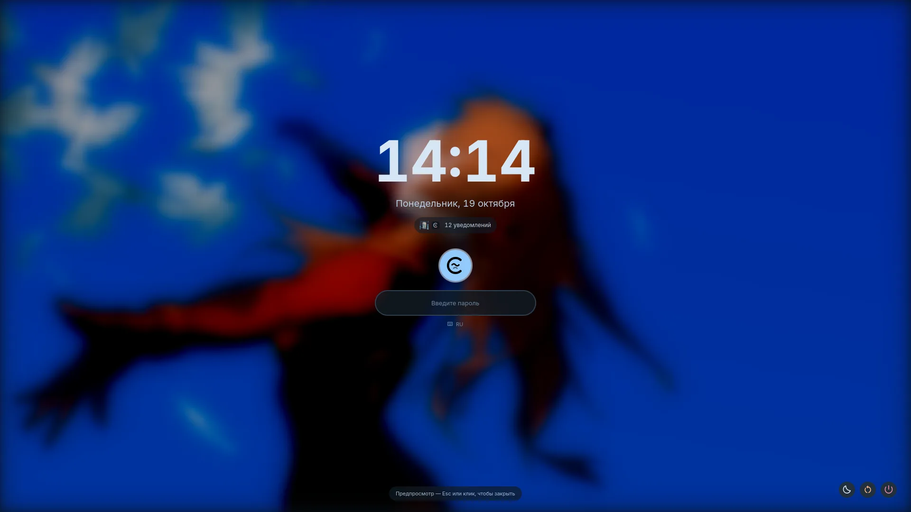<br><sub><b>Lock screen</b> — your wallpaper under frosted glass, player and notifications</sub></td>
</tr>
<tr>
<td>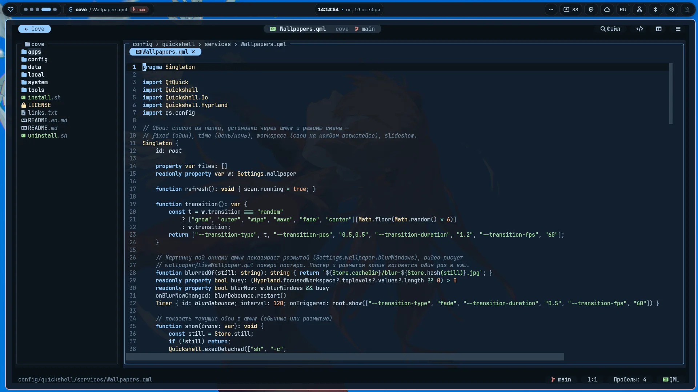<br><sub><b>Cove Code</b> — a terminal editor of its own: tree, tabs, mouse, no modes</sub></td>
<td>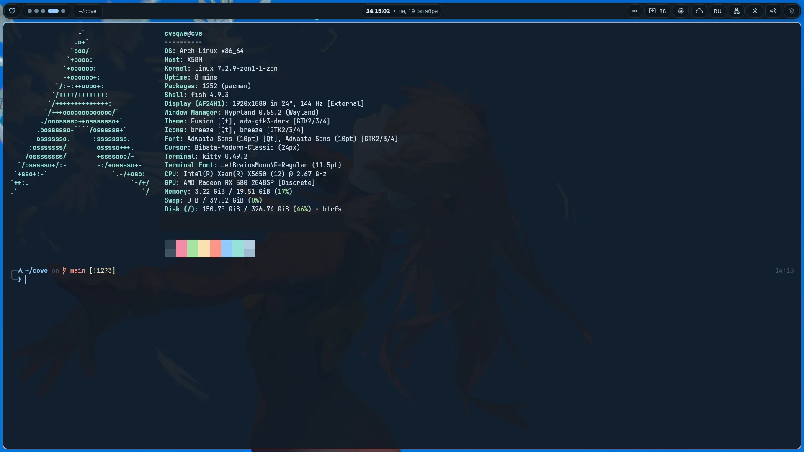<br><sub><b>Terminal</b> — kitty + fish + starship, palette from the same wallpaper</sub></td>
</tr>
<tr>
<td>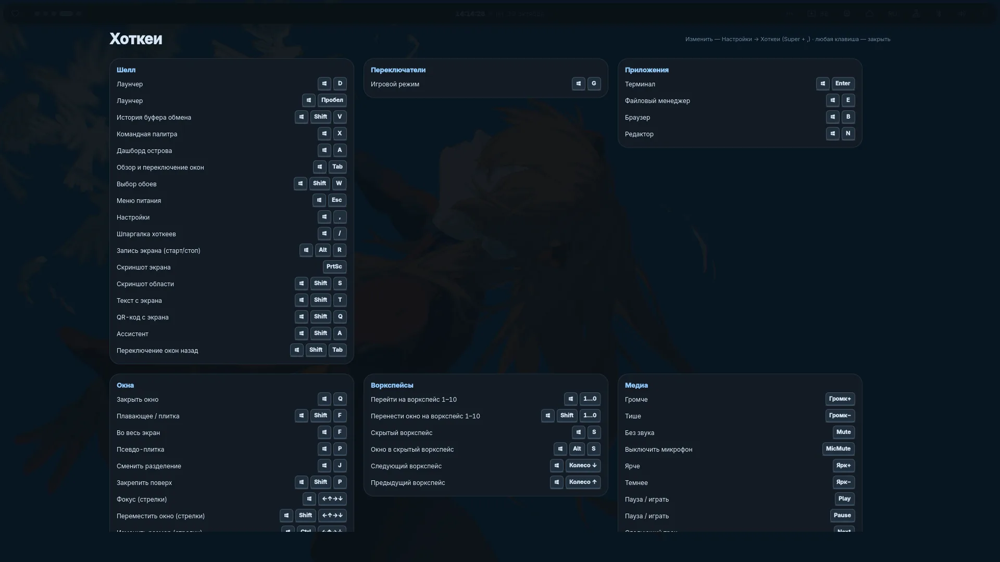<br><sub><b>Cheatsheet</b> — every hotkey on one screen, <kbd>Super</kbd> + <kbd>/</kbd></sub></td>
<td>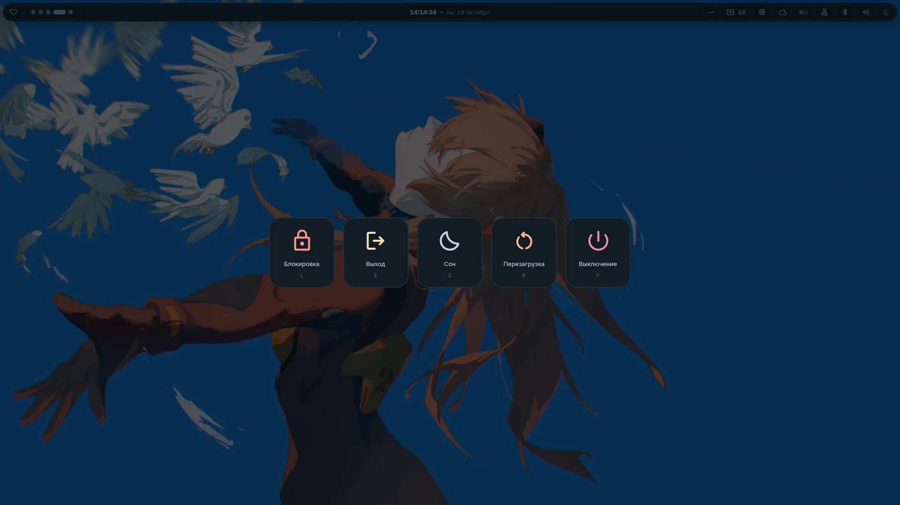<br><sub><b>Power menu</b> — every action has its own key</sub></td>
</tr>
</table>

## One wallpaper — one palette

Cove takes colors from the wallpaper (or the cover of the playing track) and hands them to everything:

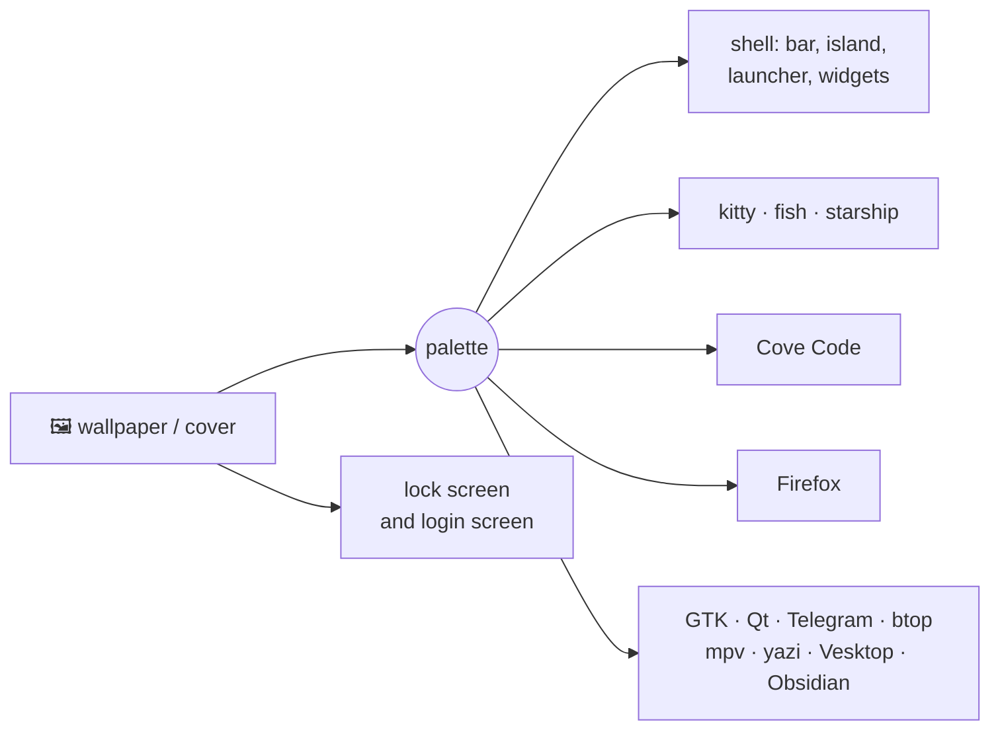

Nothing needs a restart — it all changes on the fly.

## What's inside

<details open>
<summary><b>🐚 A Quickshell-based shell</b></summary>
<br>

- **Bar** — 8 styles: Notch, Drops, Capsules, Glass, Islands, Tiles, Outline, Classic.
  Every module is toggled and moved with the mouse.
- **Dynamic island** — clock, player with a spectrum, notifications, volume, screenshot preview;
  expands on hover with quick actions.
- **Desktop widgets** — 19 of them (clock, weather, player, spectrum, tasks, calendar…)
  with an editor right on the desktop.
- **Wallpapers** — day/night schedule, one per workspace, slideshow, live video wallpapers.
- **Tools** — screenshots with an editor, screen recording, text and QR from the screen, color picker,
  notes, focus timer, alarms, downloads, window overview on <kbd>Super</kbd> + <kbd>Tab</kbd>.
- **Assistant** in the launcher — ask anything with `*`.
- **Own lock screen, login screen and boot splash** (Plymouth + Limine) — all in the same style.
- **Settings** — hotkeys with shortcut recording, window rules, style profiles, input, autostart,
  dotfiles backup to git.
- Russian and English interface.

</details>

<details>
<summary><b>⌨️ Launcher: one character — another mode</b></summary>
<br>

| Prefix | What it does | Example |
|:---:|---|---|
| — | apps (fuzzy search, favorites) | `fire` |
| `=` | calculator and converter | `=2^10`, `=100 usd in eur` |
| `/` | files | `/report` |
| `>` | run a command in the terminal | `>htop` |
| `!` | site search | `!yt cats` |
| `?` | web search | `?weather` |
| `@` | open windows | `@telegram` |
| `:` | clipboard | `:` |
| `;` | emoji | `;fire` |
| `+` | timer | `+25m tea` |
| `<` | history | `<` |
| `#` | shell command palette | `#wallpaper` |
| `*` | assistant | `*how to compress a video` |

</details>

<details>
<summary><b>📝 Cove Code</b></summary>
<br>

A terminal editor built on Textual. It works like a regular editor: mouse, tabs, file tree,
menus, search, <kbd>Ctrl</kbd>+<kbd>C</kbd> / <kbd>Ctrl</kbd>+<kbd>V</kbd>, no modes.
Highlighting for Python, C/C++, QML, Lua, TypeScript and more. Run `cove`.
The older Neovim-based version is still there as `cove-nvim`.

</details>

<details>
<summary><b>🦊 Firefox and the terminal</b></summary>
<br>

**Firefox** recolors with the theme live. 5 layouts: floating, single row, island,
vertical tabs, classic. A custom start page.

**Terminal** — kitty + fish + starship and fastfetch. Colors come only from the ANSI palette,
so any console program fits the system style.

</details>

## Install

Requires **Arch Linux** (or a derivative). All packages come from the official repos — no AUR needed.

```sh
git clone https://github.com/cvsqwe/cove ~/cove
cd ~/cove
./install.sh
```

The installer asks about the optional parts: wallpaper pack (~700 MB), cursors, Firefox setup,
login screen, boot splash, fish as the default shell. Then log into a **Hyprland** session.

Individual steps can be run later: `./install.sh firefox`, `./install.sh wallpapers`,
`./install.sh cursors`, `./install.sh greeter`, `./install.sh boot`. All steps: `./install.sh --help`.

### How it works

Configs are installed as **symlinks** into your clone (see `links.txt`).
Anything that was in their place is moved to `~/.local/state/cove/backup-<date>/`.

- **Update:** `cd ~/cove && git pull` — and the system is already new.
- **Remove:** `./uninstall.sh` — removes the symlinks and restores your old files.
- **Your settings** live in `config/quickshell/settings.json` and are not tracked by git.
- **Monitors** (refresh rate, layout) go in `~/.config/hypr/monitors.lua`, also local.

## Hotkeys

| Keys | Action | | Keys | Action |
|---|---|---|---|---|
| <kbd>Super</kbd> <kbd>Space</kbd> | launcher | | <kbd>Super</kbd> <kbd>Q</kbd> | terminal |
| <kbd>Super</kbd> <kbd>,</kbd> | settings | | <kbd>Super</kbd> <kbd>E</kbd> | files |
| <kbd>Super</kbd> <kbd>/</kbd> | cheatsheet | | <kbd>Super</kbd> <kbd>B</kbd> | browser |
| <kbd>Super</kbd> <kbd>N</kbd> | control center | | <kbd>Super</kbd> <kbd>C</kbd> | close window |
| <kbd>Super</kbd> <kbd>A</kbd> | dashboard | | <kbd>Super</kbd> <kbd>Tab</kbd> | window overview |
| <kbd>Super</kbd> <kbd>W</kbd> | wallpapers | | <kbd>Super</kbd> <kbd>Shift</kbd> <kbd>S</kbd> | area screenshot |
| <kbd>Super</kbd> <kbd>L</kbd> | lock | | <kbd>Super</kbd> <kbd>Shift</kbd> <kbd>T</kbd> | text from screen |
| <kbd>Super</kbd> <kbd>Esc</kbd> | power menu | | <kbd>Super</kbd> <kbd>Shift</kbd> <kbd>A</kbd> | assistant |

Every shortcut can be changed in **Settings → Hotkeys** — just press the new combination.

## Credits

[Hyprland](https://hypr.land) · [Quickshell](https://quickshell.org) · [Textual](https://textual.textualize.io) ·
[Neovim](https://neovim.io) · [Pywalfox](https://github.com/Frewacom/pywalfox) · [Material Symbols](https://fonts.google.com/icons)

Wallpapers are downloaded from [dharmx/walls](https://github.com/dharmx/walls),
[D3Ext/aesthetic-wallpapers](https://github.com/D3Ext/aesthetic-wallpapers) and
[orangci/walls-catppuccin-mocha](https://github.com/orangci/walls-catppuccin-mocha) — all rights belong to their authors.
Cursors: [Bibata](https://github.com/ful1e5/Bibata_Cursor), [Catppuccin](https://github.com/catppuccin/cursors),
[Google](https://github.com/ful1e5/Google_Cursor), [macOS](https://github.com/ful1e5/apple_cursor),
[phinger](https://github.com/phisch/phinger-cursors).

## License

[GPL-3.0](LICENSE) © cvsqwe

<div align="center"><sub>made with 🌊 in a cove of its own</sub></div>
