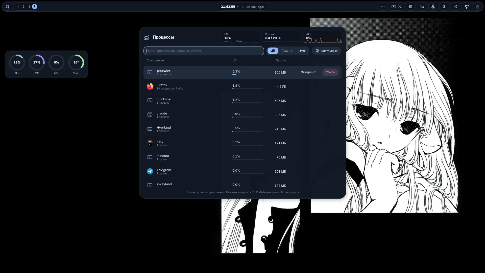
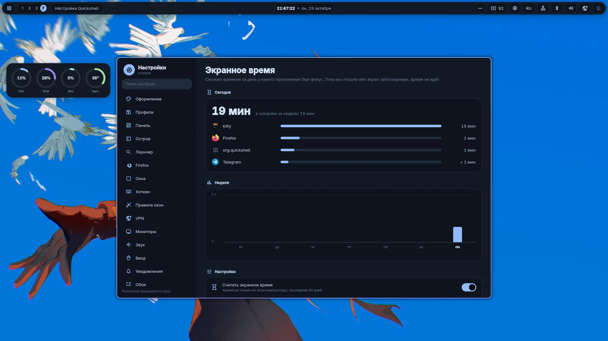

<div align="center">


# cove

Окружение рабочего стола на Hyprland: свой шелл на Quickshell, редактор, терминал и тема для Firefox.
Цвета всей системы берутся из обоев, настройки меняются в окне настроек, а не в конфигах.

[](https://archlinux.org)
[](https://hypr.land)
[](https://quickshell.org)
[](LICENSE)

**Русский** | [English](README.en.md)


</div>

## Скриншоты

| | |
|:---:|:---:|
|  |  |
| Лаунчер | Центр управления |
|  |  |
| Дашборд | Настройки |
|  |  |
| Выбор обоев | Экран блокировки |
|  |  |
| Cove Code | Терминал и fastfetch |
|  |  |
| Шпаргалка по хоткеям | Меню питания |
|  |  |
| Диспетчер задач | Экранное время |

## Возможности

### Шелл

- **Панель.** 8 стилей: Чёлка, Капли, Капсулы, Стекло, Острова, Плитки, Контур, Классика. Модули включаются и переставляются мышкой.
- **Динамический остров.** Часы, плеер со спектром, уведомления, громкость, превью скриншота. При наведении раскрывается и показывает кнопки.
- **Лаунчер.** Приложения, калькулятор, файлы, окна, буфер обмена, эмодзи, таймеры и ассистент. Режим выбирается первым символом, список ниже.
- **Центр управления.** Wi-Fi, Bluetooth, звук, ночной свет, «Не беспокоить», игровой режим.
- **Виджеты рабочего стола.** 19 штук: часы, погода, плеер, спектр, задачи, календарь и другие. Редактор открывается прямо на рабочем столе.
- **Обои.** Смена по времени суток, свои обои на каждый воркспейс, слайд-шоу, видео-обои.
- **Инструменты.** Скриншоты с редактором, запись экрана, распознавание текста и QR с экрана, пипетка, заметки, фокус-таймер, будильники, обзор окон, диспетчер задач (<kbd>Ctrl</kbd>+<kbd>Shift</kbd>+<kbd>Esc</kbd>), перевод текста с экрана, текст играющей песни, экранное время, VPN на Mihomo с подписками, защита глаз от резких вспышек.
- **Экран блокировки, экран входа и заставка загрузки** (Plymouth и Limine) в том же стиле. На блокировке и при входе стоят текущие обои.
- **Настройки.** 23 раздела: хоткеи с записью сочетаний, правила окон, профили стилей, ввод, автозапуск, бэкап дотфайлов в git.
- Интерфейс на русском и английском.

### Цвета из обоев

Палитра считается из текущих обоев или из обложки играющего трека. По ней перекрашиваются шелл, kitty, fish, starship, Cove Code, Firefox, GTK и Qt, а также Telegram, btop, mpv, yazi, Vesktop и Obsidian. Перезапускать ничего не нужно.

### Cove Code

Терминальный редактор на Textual. Работает как обычный редактор, без режимов: мышь, вкладки, дерево файлов, меню, поиск и замена, <kbd>Ctrl</kbd>+<kbd>C</kbd> и <kbd>Ctrl</kbd>+<kbd>V</kbd>. Подсветка Python, C/C++, QML, Lua, TypeScript и других языков. Запуск: `cove`. Старая версия на Neovim осталась под именем `cove-nvim`.

### Firefox и терминал

Firefox меняет цвета вместе с темой. Есть 5 вариантов интерфейса (плавающий, одна строка, остров, вертикальные вкладки, классический) и своя стартовая страница.

Терминал: kitty, fish и starship. Команда `ff` показывает fastfetch со знаком Cove, при открытии терминала выводится короткая версия. Программы в терминале используют только ANSI-цвета, поэтому тоже подстраиваются под обои.

## Лаунчер

| Префикс | Режим | Пример |
|:---:|---|---|
| | приложения | `fire` |
| `=` | калькулятор, перевод единиц и валют | `=2^10`, `=100 usd в руб` |
| `/` | файлы | `/отчёт` |
| `>` | команда в терминале | `>htop` |
| `!` | поиск по сайту | `!yt котики` |
| `?` | поиск в интернете | `?погода` |
| `@` | открытые окна | `@telegram` |
| `:` | буфер обмена | `:` |
| `;` | эмодзи | `;огонь` |
| `+` | таймер | `+25м чай` |
| `<` | история | `<` |
| `#` | команды шелла | `#обои` |
| `*` | ассистент | `*как сжать видео` |

## Установка

Нужен Arch Linux или дистрибутив на его основе. Все пакеты ставятся из официальных репозиториев, AUR не нужен.

```sh
git clone https://github.com/cvsqwe/cove ~/cove
cd ~/cove
./install.sh
```

Установщик спросит про необязательные части: пак обоев (около 700 МБ), курсоры, настройку Firefox, экран входа, заставку загрузки и fish как оболочку по умолчанию. После установки войдите в сеанс Hyprland.

Отдельные шаги можно запустить позже, например `./install.sh firefox` или `./install.sh greeter`. Полный список: `./install.sh --help`.

### Как устроена установка

Конфиги ставятся симлинками на клон репозитория, список лежит в `links.txt`. Файлы, которые были на их месте, переносятся в `~/.local/state/cove/backup-<дата>/`.

- Обновление: `cd ~/cove && git pull`.
- Удаление: `./uninstall.sh` уберёт симлинки и вернёт старые файлы.
- Ваши настройки хранятся в `config/quickshell/settings.json` и в git не попадают.
- Мониторы (частота, расположение) настраиваются в `~/.config/hypr/monitors.lua`, этот файл тоже локальный.

## Горячие клавиши

| Клавиши | Действие | Клавиши | Действие |
|---|---|---|---|
| <kbd>Super</kbd> <kbd>Space</kbd> | лаунчер | <kbd>Super</kbd> <kbd>Q</kbd> | терминал |
| <kbd>Super</kbd> <kbd>,</kbd> | настройки | <kbd>Super</kbd> <kbd>E</kbd> | файлы |
| <kbd>Super</kbd> <kbd>/</kbd> | шпаргалка | <kbd>Super</kbd> <kbd>B</kbd> | браузер |
| <kbd>Super</kbd> <kbd>N</kbd> | центр управления | <kbd>Super</kbd> <kbd>C</kbd> | закрыть окно |
| <kbd>Super</kbd> <kbd>A</kbd> | дашборд | <kbd>Super</kbd> <kbd>Tab</kbd> | обзор окон |
| <kbd>Super</kbd> <kbd>W</kbd> | обои | <kbd>Super</kbd> <kbd>Shift</kbd> <kbd>S</kbd> | скриншот области |
| <kbd>Super</kbd> <kbd>L</kbd> | блокировка | <kbd>Super</kbd> <kbd>Shift</kbd> <kbd>T</kbd> | текст с экрана |
| <kbd>Super</kbd> <kbd>Esc</kbd> | меню питания | <kbd>Super</kbd> <kbd>Shift</kbd> <kbd>A</kbd> | ассистент |

Любое сочетание можно поменять в разделе настроек «Хоткеи».

## Благодарности

Проект построен на [Hyprland](https://hypr.land), [Quickshell](https://quickshell.org), [Textual](https://textual.textualize.io), [Neovim](https://neovim.io), [Pywalfox](https://github.com/Frewacom/pywalfox) и [Material Symbols](https://fonts.google.com/icons).

Обои скачиваются из [dharmx/walls](https://github.com/dharmx/walls), [D3Ext/aesthetic-wallpapers](https://github.com/D3Ext/aesthetic-wallpapers) и [orangci/walls-catppuccin-mocha](https://github.com/orangci/walls-catppuccin-mocha), права на них принадлежат авторам. Курсоры: [Bibata](https://github.com/ful1e5/Bibata_Cursor), [Catppuccin](https://github.com/catppuccin/cursors), [Google](https://github.com/ful1e5/Google_Cursor), [macOS](https://github.com/ful1e5/apple_cursor), [phinger](https://github.com/phisch/phinger-cursors).

## Лицензия

[GPL-3.0](LICENSE)
