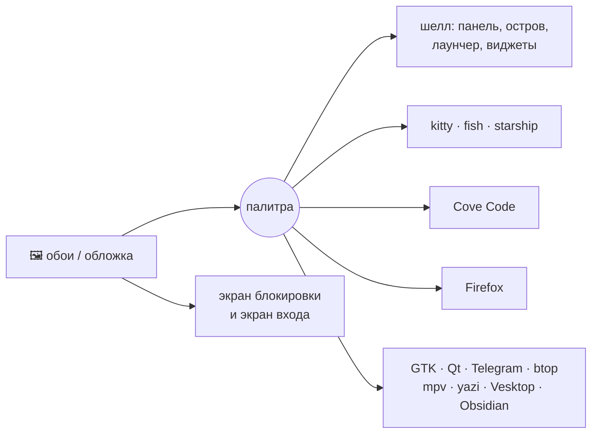

<div align="center">


# cove

### тихая бухта на Hyprland

Шелл, редактор, терминал и браузер — одна система в одном стиле.<br>
Меняешь обои — перекрашивается всё. Настраиваешь мышкой — конфиги не трогаешь.

[](https://archlinux.org)
[](https://hypr.land)
[](https://quickshell.org)
[](LICENSE)

**Русский** · [English](README.en.md)

<br>


</div>

---

## Одним взглядом

<table>
<tr>
<td width="50%"><br><sub><b>Лаунчер</b> — приложения, расчёты, файлы, окна, буфер, эмодзи и ассистент в одной строке</sub></td>
<td width="50%"><br><sub><b>Центр управления</b> — сеть, Bluetooth, звук, «Не беспокоить», игровой режим, цвета из обоев</sub></td>
</tr>
<tr>
<td><br><sub><b>Дашборд острова</b> — приветствие, календарь, погода, курсы и загрузка системы</sub></td>
<td><br><sub><b>Настройки</b> — 19 разделов, всё применяется сразу и с живым предпросмотром</sub></td>
</tr>
<tr>
<td><br><sub><b>Обои</b> — сотни картинок и живые видео-обои, вкладки по стилям</sub></td>
<td><br><sub><b>Блокировка</b> — твои обои под стеклом, плеер и уведомления</sub></td>
</tr>
<tr>
<td><br><sub><b>Cove Code</b> — свой редактор в терминале: дерево, вкладки, мышь, без режимов</sub></td>
<td><br><sub><b>Терминал</b> — kitty + fish + starship, палитра из тех же обоев</sub></td>
</tr>
<tr>
<td><br><sub><b>Шпаргалка</b> — все хоткеи на одном экране, <kbd>Super</kbd> + <kbd>/</kbd></sub></td>
<td><br><sub><b>Меню питания</b> — у каждого действия своя клавиша</sub></td>
</tr>
</table>

## Одни обои — одна палитра

Cove берёт цвета с обоев (или с обложки играющего трека) и раздаёт их всем:



Ничего не нужно перезапускать — смена происходит на лету.

## Что внутри

<details open>
<summary><b>🐚 Шелл на Quickshell</b></summary>
<br>

- **Панель** — 8 стилей: Чёлка, Капли, Капсулы, Стекло, Острова, Плитки, Контур, Классика.
  Каждый модуль включается и двигается мышкой.
- **Динамический остров** — часы, плеер со спектром, уведомления, громкость, превью скриншота;
  при наведении раскрывается с кнопками действий.
- **Виджеты рабочего стола** — 19 штук (часы, погода, плеер, спектр, задачи, календарь…)
  и редактор прямо на рабочем столе.
- **Обои** — по времени суток, свои на каждый воркспейс, слайд-шоу, живые видео-обои.
- **Инструменты** — скриншоты с редактором, запись экрана, текст и QR с экрана, пипетка,
  заметки, фокус-таймер, будильники, загрузки, обзор окон по <kbd>Super</kbd> + <kbd>Tab</kbd>.
- **Ассистент** в лаунчере — спроси что угодно через `*`.
- **Свой экран блокировки, экран входа и заставка загрузки** (Plymouth + Limine) — в том же стиле.
- **Настройки** — хоткеи с записью сочетаний, правила окон, профили стилей, ввод, автозапуск,
  бэкап дотфайлов в git.
- Русский и английский интерфейс.

</details>

<details>
<summary><b>⌨️ Лаунчер: один символ — другой режим</b></summary>
<br>

| Префикс | Что делает | Пример |
|:---:|---|---|
| — | приложения (нечёткий поиск, избранное) | `fire` |
| `=` | калькулятор и конвертер | `=2^10`, `=100 usd в руб` |
| `/` | файлы | `/отчёт` |
| `>` | команда в терминале | `>htop` |
| `!` | поиск по сайтам | `!yt котики` |
| `?` | поиск в интернете | `?погода` |
| `@` | открытые окна | `@telegram` |
| `:` | буфер обмена | `:` |
| `;` | эмодзи | `;огонь` |
| `+` | таймер | `+25м чай` |
| `<` | история | `<` |
| `#` | палитра команд шелла | `#обои` |
| `*` | ассистент | `*как сжать видео` |

</details>

<details>
<summary><b>📝 Cove Code</b></summary>
<br>

Свой терминальный редактор на Textual. Работает как обычный: мышь, вкладки, дерево файлов,
меню, поиск, <kbd>Ctrl</kbd>+<kbd>C</kbd> / <kbd>Ctrl</kbd>+<kbd>V</kbd>, никаких режимов.
Подсветка Python, C/C++, QML, Lua, TypeScript и других. Запуск — `cove`.
Прежняя версия на Neovim осталась как `cove-nvim`.

</details>

<details>
<summary><b>🦊 Firefox и терминал</b></summary>
<br>

**Firefox** перекрашивается вместе с темой на лету. 5 видов интерфейса: плавающий, одна строка,
остров, вертикальные вкладки, классический. Своя стартовая страница.

**Терминал** — kitty + fish + starship и fastfetch. Цвета только из ANSI-палитры, поэтому
любая консольная программа выглядит в стиле системы.

</details>

## Установка

Нужен **Arch Linux** (или производный). Все пакеты — из официальных репозиториев, AUR не нужен.

```sh
git clone https://github.com/cvsqwe/cove ~/cove
cd ~/cove
./install.sh
```

Установщик спросит про необязательное: пак обоев (~700 МБ), курсоры, настройку Firefox,
экран входа, заставку загрузки, fish по умолчанию. Затем войдите в сеанс **Hyprland**.

Отдельные шаги можно запустить потом: `./install.sh firefox`, `./install.sh wallpapers`,
`./install.sh cursors`, `./install.sh greeter`, `./install.sh boot`. Все шаги: `./install.sh --help`.

### Как это устроено

Конфиги ставятся **симлинками** на клон репозитория (список — `links.txt`).
Всё, что лежало на их месте, переезжает в `~/.local/state/cove/backup-<дата>/`.

- **Обновить:** `cd ~/cove && git pull` — и система уже новая.
- **Удалить:** `./uninstall.sh` — уберёт симлинки и вернёт ваши старые файлы.
- **Ваши настройки** хранятся в `config/quickshell/settings.json` и в git не попадают.
- **Мониторы** (частота, расположение) — в `~/.config/hypr/monitors.lua`, он тоже локальный.

## Горячие клавиши

| Клавиши | Действие | | Клавиши | Действие |
|---|---|---|---|---|
| <kbd>Super</kbd> <kbd>Пробел</kbd> | лаунчер | | <kbd>Super</kbd> <kbd>Q</kbd> | терминал |
| <kbd>Super</kbd> <kbd>,</kbd> | настройки | | <kbd>Super</kbd> <kbd>E</kbd> | файлы |
| <kbd>Super</kbd> <kbd>/</kbd> | шпаргалка | | <kbd>Super</kbd> <kbd>B</kbd> | браузер |
| <kbd>Super</kbd> <kbd>N</kbd> | центр управления | | <kbd>Super</kbd> <kbd>C</kbd> | закрыть окно |
| <kbd>Super</kbd> <kbd>A</kbd> | дашборд | | <kbd>Super</kbd> <kbd>Tab</kbd> | обзор окон |
| <kbd>Super</kbd> <kbd>W</kbd> | обои | | <kbd>Super</kbd> <kbd>Shift</kbd> <kbd>S</kbd> | скриншот области |
| <kbd>Super</kbd> <kbd>L</kbd> | блокировка | | <kbd>Super</kbd> <kbd>Shift</kbd> <kbd>T</kbd> | текст с экрана |
| <kbd>Super</kbd> <kbd>Esc</kbd> | меню питания | | <kbd>Super</kbd> <kbd>Shift</kbd> <kbd>A</kbd> | ассистент |

Все сочетания меняются в **Настройки → Хоткеи** — нажми новую комбинацию, и всё.

## Благодарности

[Hyprland](https://hypr.land) · [Quickshell](https://quickshell.org) · [Textual](https://textual.textualize.io) ·
[Neovim](https://neovim.io) · [Pywalfox](https://github.com/Frewacom/pywalfox) · [Material Symbols](https://fonts.google.com/icons)

Обои скачиваются из [dharmx/walls](https://github.com/dharmx/walls),
[D3Ext/aesthetic-wallpapers](https://github.com/D3Ext/aesthetic-wallpapers) и
[orangci/walls-catppuccin-mocha](https://github.com/orangci/walls-catppuccin-mocha) — права на них у авторов.
Курсоры — [Bibata](https://github.com/ful1e5/Bibata_Cursor), [Catppuccin](https://github.com/catppuccin/cursors),
[Google](https://github.com/ful1e5/Google_Cursor), [macOS](https://github.com/ful1e5/apple_cursor),
[phinger](https://github.com/phisch/phinger-cursors).

## Лицензия

[GPL-3.0](LICENSE) © cvsqwe

<div align="center"><sub>сделано с 🌊 в своей бухте</sub></div>
